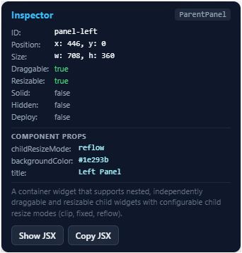

# HeadWind React-UI-Library

Install the library `npm i @devcrish/headwind`.

React widgets that you can drag, resize and place in your browser. Create UI in react like a complete UI/UX engine built-in to your react library. 
* Just import the Widget you want from the library
* Edit the component with properties like using Tailwind 
* Drag & resize your components in the browser by running your project `npm run dev`
* Copy the jsx code from the **Inspector Panel**.  (*Do not forget to add the ending tag yourself if needed*)
* 
* Do `deploy={true}` on the Canvas component which is the parent component to all the widgets.
* And there you have a webpage.
* You can now build the project `npm run build` and serve your dist/ folder.
* Import the library then open it inside your node_modules/ and check `src/widgets` Scroll down to see all the properties of a widget.

### Features & Power
1. The module accepts json data from the backend to update the UI. `{"id":"< Widget's ID >", "text":"Hello World!", "Color":"Red"}`
2. You can also create new components by sending json from your backend. (Tip: Also send the `'id'` while putting a new widget on the UI.)
3. The library can communicate via SocketIO & MQTT just add the link to your backend server or Mosquito MQTT to the <UI.Canvas> component. 
* `<UI.Canvas deploy={false} mqttUrl="ws://localhost:9001" mqttTopic="renderReactUI" socketUrl="http://localhost:5000" socketEvent="customSyncUI" >`
4. Secure MQTT & socketIO features will be added for enhanced security & easy authentication between the frontend & backend.
5. The library is built with performance on mind so 100s of UI components on your page does not break or stutter the page. 


## Use it
```jsx
import { UI, UIProvider } from "@devcrish/headwind";

<UIProvider deploy={false} config={{ isDraggable: true }}>      {/* optional global defaults */}
  <UI.Canvas>
    <UI.Text text="Hello World" />               {/* no layout props needed */}
    <UI.Button text="Submit" />
    <UI.Text text="Moved" position={{ x: 400 }} />  {/* only x set; y is automatic */}
  </UI.Canvas>
  <UI.MasterPanel />                             {/* checkboxes: dragging, resizing, deploy page */}
  <UI.ExportPanel />                             {/* copy JSON / JSX */}
</UIProvider>
```
Workflow: drag/resize -> read the overlay or press **Copy JSX** -> paste -> add `deploy` (or `<UI.Canvas deploy>` for the whole page).

## Common props (every widget)
`id`, `position` ("auto" or `{x?, y?}`), `size` (`{width?, height?}`), `isDraggable`, `isResizable`, `deploy`, `hidden`, `solid`,
`onPositionChange`, `onSizeChange`, `onLayoutChange`.

## Precedence (later wins)
1. Built-in defaults (`defaultUIConfig`, then the widget's own, e.g. Button is 140x44)
2. `<UIProvider config={...}>`
3. The widget's props

**Partial merging of Position & Size:** position values `x, y` and size values `height, width` merge independently by their key rather than replacing the entire object, i.e, you can only define `height` w/o `width` the width will be the default one.

**Auto positioning:** position: `auto` triggers sequential placement below the previous auto-positioned widget. The resolved coordinates are reflected in the overlay, hooks, and export/inspector panel.

**Deploy rules:** editable = page not deployed AND widget not deployed. Page deployed = `<UI.Canvas deploy>` OR the master panel's Deploy checkbox. Page deploy always wins, even over `deploy={false}`. The master panel's Dragging/Resizing checkboxes are runtime controls (highest precedence, but they can only switch things off). Turning page deploy off again only unlocks widgets that are not individually deployed.

## `hidden` and `solid`
- `hidden` (default `false`): `true` hides the widget. Its geometry is kept and readable, its content stays mounted (state is not lost), it shows no editing tools, it does not make the page grow, and solid widgets ignore it. Toggle it with React state.
- `solid` (default `false`): `true` makes the widget **make room for itself**. When it grows (resize handles, or a bigger `size` prop in your code), appears (`hidden` goes false, or `solid` is switched on) or loads overlapping others, every visible widget it would cover is pushed aside, and anything those widgets bump into is pushed along the same way. **Dragging is never blocked**: you can still drag any widget over any other. Shrinking never pulls neighbours back. Pushed positions are live values: use the export to hardcode them.
- Both are ordinary layout props: they work on every widget including `createWidget` widgets, can be set globally with `<UIProvider config={{ solid: true }}>` and overridden per widget, and work on a deployed page. Details: `docs/06-how-features-work.md` sections 6.17 and 6.18.

## Special-Widgets (Panels) (put them inside the Canvas or the Provider, removed when deployed)
- `<UI.MasterPanel />`: checkboxes for **Dragging**, **Resizing** and **Deploy whole page**. Dragging/Resizing OFF stops every widget; ON never overrides a widget's own `isDraggable={false}` / `isResizable={false}`. Deploy hides all editing tools but the panel stays so you can switch back. If you deploy in code with `<UI.Canvas deploy>`, the panel hides itself. Prop: `position` (`"top-right"` default, `"top-left"`, `"bottom-right"`, `"bottom-left"`).
- `<UI.ExportPanel />`: copy layout as JSON or JSX. Hidden when the page is deployed.
- `<UI.InspectorPanel />`: inspects the selected widget's properties, geometry, and layout flags. Includes a **Show JSX** toggle and **Copy JSX** button to hardcode the widget into React code. Prop: `position` (`"bottom-left"` default, `"bottom-right"`, `"top-left"`, `"top-right"`). Hidden when the page is deployed.
- `<UI.WidgetListPanel />`: lists all canvas widgets by ID and type in a draggable, collapsible panel. Click the eye icon next to any widget to toggle its visibility (appear/disappear, like Blender's outliner). Collapsible so only "Widget List" and the drag handle remain visible, and draggable anywhere on the page. Hidden when the page is deployed.

## Canvas size
- **Full page (default)**: with no `width`/`height` the canvas covers the whole browser page, edge to edge, before and after deploy. It is pinned to the top-left of the page, so padding or centering from your other CSS cannot leave gaps. If a widget is lower or further right than the screen, the canvas grows and the page scrolls normally.
- **Fixed box**: `<UI.Canvas width={800} height={400}>` makes a box that scrolls inside itself (use this for several canvases or a canvas inside a bigger page).
- A full-page canvas covers everything, so put your content inside it as widgets. Make sure your page has no default margin (`body { margin: 0 }`).

## Hooks
- `useUIElement("id")` -> `{ id, type, position, size, isDraggable, isResizable, deploy, hidden, solid }` (live)
- `useUILayout()` -> `{ elements, selectedId, select, pageDeployed, master, setMaster, exportGeometry(), exportJSON(), copyJSON() }`
- `useUIConfig()` -> global defaults

## Custom widgets
```jsx
const Clock = createWidget({ type: "Clock", defaults: { size: { width: 200, height: 56 } }, meta: { description, props }, render: ClockContent });
```
`render` is a normal React component; dragging, resizing, inspection, deploy and export come for free.

## Real-time Socket.IO Synchronization
Update component properties in real time from a backend over Socket.IO:

```jsx
<UI.Canvas socketUrl="http://localhost:5000">
  <UI.Text id="heading" text="Initial Title" />
  <UI.Button id="formSubmitBtn" text="Old Button" />
</UI.Canvas>
```

The library listens on the Socket.IO event `'renderReactUI'`. When the backend emits a list of component configs:
```json
[
  { "id": "heading", "fontSize": 50, "fontWeight": 300, "solid": true },
  { "id": "formSubmitBtn", "varient": "Danger", "text": "Submit" }
]
```
- Only specified properties are updated; all other properties stay as they are.
- If a component does not exist on the canvas, it is automatically created and rendered with the specified config.
- Layout flags (`solid`, `hidden`, `deploy`, `position`, `size`) are supported; setting `solid: true` pushes overlapping widgets aside automatically.
- **Custom Socket Event**: You can specify a custom Socket.IO event name using `socketEvent` (or `event`) on `<UI.Canvas>` or `useSocketUI({ socketEvent: "customEvent" })` (defaults to `"renderReactUI"`).
- A ready-to-run Python Flask backend is provided in `example/backend/`. Run with `python example/backend/app.py`.

## Real-time MQTT Synchronization
Subscribe to an MQTT broker over WebSockets (e.g. Mosquitto on port 9001) to update components in real time:

```jsx
<UI.Canvas mqttUrl="ws://localhost:9001" mqttTopic="renderReactUI">
  <UI.Text id="heading" text="Initial Title" />
  <UI.Button id="formSubmitBtn" text="Old Button" />
</UI.Canvas>
```

- **Default Topic**: Subscribes to `'renderReactUI'` by default if `mqttTopic` is omitted (`<UI.Canvas mqttUrl="ws://localhost:9001">`).
- **Custom Topic**: Specify any custom topic or wildcard pattern via `mqttTopic` (or `topic`).
- **Hook**: Alternatively use `useMqttUI({ mqttUrl, mqttTopic })` or `UI.useMqttUI(...)`.
- **Payload**: Standard JSON array or single object. Supports all content props (`text`, `color`, `variant`, etc.) and layout props (`position`, `size`, `hidden`, `solid`, `deploy`, etc.). Dynamically creates new widgets if the element ID does not exist.
- **Backend Publishing**: Use `example/publish_mqtt.py` with Python `paho-mqtt` to publish updates to your Mosquitto broker over TCP (port 1883):
  ```bash
  ./example/venv/Scripts/python example/publish_mqtt.py
  ```


## `UI.ParentPanel` (nested, independently editable containers)
Container widget (`UI.ParentPanel`) that supports independently draggable and resizable child widgets with configurable child resize behavior:
```jsx
<UI.ParentPanel
  id="workspace"
  position={{ x: 40, y: 40 }}
  size={{ width: 800, height: 500 }}
  resizableX={true}
  resizableY={true}
  childResizeMode="clip"
  backgroundColor="#172554"
  opacity={0.95}
  hidden={false}
>
  <UI.Text text="Heading" />
  <UI.Button text="Submit" />
</UI.ParentPanel>
```
- **Independent child editing:** Children are draggable and resizable within the ParentPanel. Positions are relative to the parent content coordinate system.
- **Explicit parent drag handle:** The parent includes a dedicated drag handle so dragging a child never accidentally drags the parent.
- **Group movement:** Dragging the parent moves all children visually while preserving child local coordinates.
- **Child resize modes (`childResizeMode`):**
  - `"clip"` (default): Preserves child positions and dimensions. Content outside bounds is clipped. Shrinking the parent does not delete children; expanding restores them.
  - `"fixed"`: Preserves child positions and dimensions. Supports `overflow: visible` and scrolling (`overflow="auto"` / `"scroll"`).
  - `"reflow"`: Responsive flex/grid layout that rearranges children into available space when the parent resizes, with configurable `gap`, `alignItems`, `justifyContent`, and `minChildWidth`.
- **Independent permissions:** `resizableX`, `resizableY`, `minWidth`, `minHeight`, `maxWidth`, `maxHeight`. Setting `resizableX={false}` on the parent does not disable child horizontal resizing.
- **Nested ParentPanels:** Arbitrarily nest ParentPanels with recursive root coordinate calculation.
- **Geometry API:** `useUIElement(id)` and export report `position` (parent-relative), `parentRelativePosition`, `rootPosition`, and `parentId`.

## Coordinates and limits
- Pixels from the canvas top-left for root widgets, or from parent content top-left for nested widgets in a `UI.ParentPanel`. Dragging uses pointer movement, so page scrolling does not change the values.
- One canvas per `UIProvider`.
- Fixed pixel positions are **not responsive** unless wrapped in a `UI.ParentPanel` with `childResizeMode="reflow"`.
- A press that moves less than 4px is a click, so buttons work in edit mode too.

**The library is not completely ready for production as security & authentication between the frontend & backend are still needed to be added as I intend the users to use the built-in socketIO & MQTT Hooks in the Canvas. You can edit the `useSocketUI.js` & `useMqttUI.js` to add your own security & authentication yourself.**